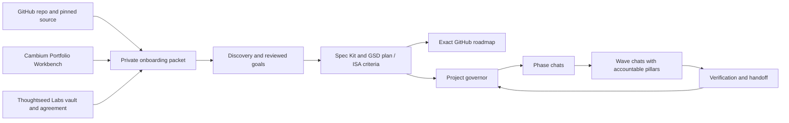

# Project onboarding runbook

The CLI uses the existing Workbench catalog and reviewed repository registry. The Labs vault supplies classification, client and agreement evidence. Workbench visibility, GitHub access, a planning entry and authority to execute are four different facts.



## Start and resume

From Cambium, with a Node version that reads the repo’s TypeScript modules:

```sh
npm run project:onboard -- branch:example --github --out example
npm run project:onboard -- --root "$PROJECT_CHECKOUT" --github --out example
npm run project:onboard -- branch:example --github --primary "$PRIMARY_REPO" \
  --board "$BOARD_OWNER_AND_NUMBER" --source "$REVIEWED_SCOPE_FILE" --out example
```

`--github` only reads. Without `--out`, the CLI emits the packet to stdout; prefer `--out` in chat for private material. The reports are `ecosystem-map.md`, `discovery.md`, `roadmap.md`, `pillars.md` and `packet.json` under ignored `.local/project-onboarding/<label>/`. Commit review and progress files only to a separately approved private system; keep the working copies here. The CLI inventories one shallow project family. Other checkouts or approved nonstandard source files can be named explicitly; files outside the observed checkouts, selected vault, Cambium or project umbrella are unavailable. A GitHub-only repository has metadata and a branch pin: inspect its scoped files by exact ref before asserting source behavior.

For a requested workspace setup or migration, use the [workspace mapping](#workspace-mapping-across-hosts) steps. Keep host readback beside the packet so an in-progress discovery review can keep its evidence fingerprint.

Read the agreement in its authorized local context. Record the precise edition/date, evidence of signature, changes and legal/client approval owner. Capture deliverables, exclusions, handoffs, data/asset ownership, accessibility, security, support and timing only where evidence exists. Store short sanitized decisions and source references. A register claim about a signed copy stays distinct from independent inspection of the original. Use official guidance when a gap depends on current platforms or standards; the question bank includes primary references. Compare recommendations to the product and the actual agreement before using them in the roadmap.

Create the review and progress documents beside the reports, then pass their paths with `--review` and `--progress` using the same source and board flags. Copy `workId` and `inputDigest` from the prepared packet. On evidence drift, compare the affected source hashes, re-confirm consequential decisions, then bind the reviewed inputs to the new digest. Never carry an obsolete answer forward automatically. Use `deferred` with an owner and dependency, or `not-applicable` with a reason. The next three unresolved decisions remain visible. When customization is confirmed, use the 30 rows as a completeness check; ask only remaining material questions.

Review input example (replace all sample refs with exact `ref` values from `packet.json`):

```json
{
  "schema": "cambium.project-onboarding-review.v1",
  "workId": "branch:example",
  "inputDigest": "<fingerprint from packet.json>",
  "contract": {"state":"mixed","note":"The register records one executed phase; the proposed extension is unsigned.","sources":["vault:60-client-ecosystem/example/contracts/README.md"]},
  "customization": {"state":"missing","note":"The client has not signed off the support and pilot rules.","sources":["vault:60-client-ecosystem/example/project-brief.md"]},
  "priority": ["Q02", "Q06", "Q04"],
  "questions": {"Q02":{"question":"Which signed exhibit governs the pilot?","recommendation":"Pin the executed exhibit and identify the party who can approve a change.","sources":["vault:60-client-ecosystem/example/contracts/README.md"]}},
  "goals": [{"id":"pilot-baseline","rail":"mobile","stage":"M1 · Pilot", "basis":"confirmed-scope","state":"needs-decision","outcome":"A client reviewer can complete the supported journey.","measure":"Pass the accepted journey matrix on one signed iOS and one signed Android build.","gate":"Named acceptance owner and approved data scope.","dependsOn":[],"sources":["repo:owner/example:specs/001-pilot/spec.md"],"issue":"https://github.com/owner/example/issues/42"}],
  "rails": {"mobile":{"state":"active-in-proposal","repositories":["owner/example"],"proof":"Record device, build digest, Git pin and reviewer result."}}
}
```

Progress input example:

```json
{
  "schema": "cambium.project-onboarding-progress.v1",
  "workId": "branch:example",
  "inputDigest": "<same fingerprint>",
  "answers": {"Q02":{"state":"deferred","by":"Project owner","note":"Waiting for the original exhibit from the authorized client approver."}},
  "children": [{"key":"pilot-device-check","rail":"mobile","state":"terminal","worktree":"none","pending":[],"terminalReceipt":"receipt:device-check","acceptanceRef":"isa:pilot-01","handoffRef":"handoff:pilot-device-check"}]
}
```

The output `archive-candidate` signifies receipt shape and a safe reported state. The operator still verifies each reference and actual chat/worktree status. Keep real chat IDs and host/root bindings in a separate ignored local inventory. Do not use commercial details, transcripts, or credentials as answer text.

## Workspace mapping across hosts

1. **Inventory both hosts.** For Thoughtseed, start at the saved local Codex project on the MacBook Pro, where Cursor is primary and Codex is secondary. Use the Mac mini as the server and an interactive surface. Read the scoped migration handoffs in `~/.local/share/mac-migration/phase2` where available. Use an existing verified SSH route or the mounted migration archive to inspect the source. Date each observation and record gaps in live host access. For each checkout, record the host, exact Git root and `origin`, branch and full HEAD, dirty state, linked worktree pins, local refs and stash presence. Check the existing handoff and GitHub refs before deciding what needs to be carried forward. Use `git rev-parse --show-toplevel`, `git rev-parse --verify HEAD`, `git remote get-url origin`, `git --no-optional-locks status --short --branch`, `git worktree list --porcelain` and `git show-ref --heads --tags`. Sanitize URLs and keep private file bodies out of the inventory.
2. **Reconcile repository roles.** Match the owner-qualified repo and immutable GitHub ID from `gh repo view` to the vault and the reviewed Workbench components. A stale catalog or workspace path is a discrepancy to record. Relovo illustrates a family of sibling checkouts with retained legacy source. ParkArea illustrates a primary planning repo with independently verified companion sources. Reuse a matching primary checkout and the existing planning binding. For a missing active checkout, use a fresh sibling clone at the verified default branch unless a specific branch is required. Keep historical and archived checkouts as provenance. Preserve source worktrees and handoffs where they live, and copy needed unpublished commit tips to local archival refs or a verified bundle. Verify the saved refs by full SHA and leave active branches and dirty files in place.
3. **Add missing native mappings.** Read Codex `list_projects` and match by host and resolved Git root. Reuse an exact match. Add each selected missing repository root from **Add new project** in the Codex sidebar (`Cmd+O` on macOS). Use an installed cockpit helper only where it owns the requested mapping and its check resolves the exact root. The CLI's workspace open, Temperance trust and a cockpit catalog entry each need native readback before counting a mapping. If the app control needs an operator, give them the exact missing folders and read back the project list after selection. [Codex project controls](https://learn.chatgpt.com/docs/reference/troubleshooting#remove-a-project-from-the-sidebar)
4. **Update the portable map and verify.** Use the existing `config/projects/registry.v1.json` in the Temperance engine checkout for active Thoughtseed components. Follow the existing `part_of` convention for a sibling, preserve existing IDs and scope bindings, and use paths relative to the configured projects directory. Run `bin/te-project-render check` and `bin/te-project-render path <project-id>` from the engine checkout on the target host. Confirm each root's Git origin and HEAD. Enrollment and trust writes have their own scope. Read Codex `list_projects` again and record each observed ID, host, Git flag and path. Record unresolved mappings and any retained source state in `.local/project-onboarding/<label>/workspace-map.md` with dated evidence links.

## Sapling product discovery

Run the same workflow for a reviewed `sapling:<id>`. For a new name or a product hypothesis derived from a Branch, choose `--track sapling --out <separate-label>`. Keep the registry classification and any agreement or founder, data, ownership, trademark, payment and launch gates in their original locations. This track makes a product proposal even if a commercial delivery contract does not apply. It does not create a Sapling or publish to the Branch board.

Start with the problem, reachable audience and direct or manual alternatives. Reuse original interviews, pilot data and public first-party sources. Date each observation, separate observed facts from inference, and record what would contradict it. An alternative’s capabilities establish a baseline for comparison; they do not measure demand, adoption or local supply. Research from private users needs the existing scoped permission and data controls. Choose a small, timeboxed test and agreed denominator, target and baseline. If the baseline is absent, keep it `null`; do not count fixtures in customer demand. Use the original Sapling lifecycle and GSD sequence after review.

Add a `sapling` object to the review input with:

| Field | Contents |
| --- | --- |
| `sources` | `id`, `kind` (`first-party`, `competitor`, `standard`, `repo`, `pilot`), `title`, HTTPS or observed source `ref`, `observedOn`, `observation`, `limit` |
| `hypothesis` | `segment`, `job`, `claim`, `alternative`, `unknown`, and evidence IDs in `sources` |
| `goal` | `outcome`, `metric`, `numerator`, `denominator`, `event`, `targetPercent`, `baselinePercent` (or `null`), `minSample`, `window`, `decision`, `guardrails`, `nonGoals` |
| `experiment` | `method`, `comparison`, `reviewGate`, `stop` |
| `flows` | Each `id`, `actor`, `intent`, ordered `steps`, `failure`, checkable `proof`, `sources`, and optional `event`. Exactly one flow owns the goal completion event. |

With a current research review, the workflow writes `market-evidence.md`, `spec-kit-spec.md`, `spec-kit-plan.md`, `spec-kit-tasks.md`, and `goal-flow.md`. The trace links evidence to the goal and each story, flow and verification criterion. Review in the context of the existing constitution; use the repo’s established Spec Kit paths for any adopted draft. A flow that does not help the selected outcome or prove a guardrail belongs in a different proposal. To validate a product graph separately, use the owning [Sapling Lifecycle](../sapling-lifecycle/SKILL.md) read-only graph workflow. A design trace cannot establish market validation, graph admission, runtime readiness or a released product.

## Spec Kit and roadmap

Use the existing constitution; write or reconcile `spec.md` for what matters to users, then `plan.md` for implementation and `tasks.md` for the work. Use clarify and consistency checks for the scope that has meaningful ambiguity. Reference approved clauses and changes, user stories and success criteria, relevant standards and an ISA proof. A contract target, technical proposal and measured result occupy separate fields. Carry the finite sequence and dependencies through the current GSD plan.

Before an authorized GitHub write, show the exact owner, board and allowed audience; issue IDs or proposed drafts, fields, date source, and removals if any. Private contracts stay private; draft board content should carry only the minimal safe scope and links. If the local Temperance planner binding is present, cross-check it using `node "$TEMPERANCE_ROOT/router/temperance-gh-plan.mjs" --cwd "$PROJECT_ROOT" --status --json`. The current legacy enroll command can select by title and its broad sync can create phase issues. Use exact board and item IDs for this workflow. A positively verified reused board may contain the repo’s issues without a formal repo link; a link is still a separate effect.

- **Reuse:** re-read the exact board with `gh project view` and `gh project item-list`, use `gh project item-add` only for approved existing issue URLs that are absent, and edit only reviewed fields with their observed IDs. Preserve the existing issue work and unrelated views.
- **Create:** if a fresh repo and owner inventory plus the owner’s reviewed disposition establish no existing board to reuse, use the supported `gh project create --owner <owner> --title <reviewed-title> --format json` once. Record its exact ID/number and confirm it is private before including any items. Use `gh project link <number> --owner <owner> --repo <owner/repo>` if approved. A timeout or partial result calls for readback before retrying. No title-only binding, duplicate or automatic archive.
- **Timeline and verification:** configure the supported [GitHub roadmap layout](https://docs.github.com/en/issues/planning-and-tracking-with-projects/customizing-views-in-your-project/customizing-the-roadmap-layout) with verified Start/Target dates or iterations using the UI. Use unallocated dates for held work. Read the exact project and changed items back, record per-item success or error, and update the existing handoff pointer. A planned card grants no execution admission. An unbound, conflicting, stale or inaccessible board stays held until reconciled.

## Governor, pillars, and existing jobs

Check for existing chats before creating any. In Codex, use the app’s supported project and chat tools. Create a governor first if needed, and create only the authorized active pillars. Native Codex chats are peers; nesting is an explicit relationship in each chat’s kickoff and the local inventory. Use a bounded child agent only when requested and that surface supports it. For a requested Claude or other client, reuse its native session handles and record any limitations rather than treating a substitute as equivalent.

Use the [phase and wave workflow](workflows/phases-and-waves.md) to bind parent chats. Give every pillar its WorkObject, repo(s), branch/commit source, specific interfaces owned, agreed goal, verification command/readback, dependencies, and owner handoff. Give every worker a narrower scope and one parent. Main chat is the integration and acceptance coordinator. Existing GSD plans and ISA decide what moves; the next-wave command can write local proposal files, so run it only in its owning project when preparing a selected wave. It does not admit work. Use source-pinned tasks and owner decisions through Cambium’s signed admission/claim path. Hermes executes only the exact admitted task and returns an attributable terminal receipt to the existing owner.

Temperance classifies the task without changing the active native model or pool. A deliberate supported CLI launch may use an already agreed pool; preserve that pool. Hosted Phloem at `https://omniroute.thoughtseed.space` owns inference routing, quota and cooldown for its clients. Use the existing wrapper/session with no new account, model configuration, or gateway. A provider receipt is needed to attribute an actual model/account. Native application identity without a receipt stays unknown. Use existing hook contracts for startup/prompt/end continuity, including Vestibule and Nutrix; no onboarding hook runs at session start or stop.

Use the [scheduled review](workflows/scheduled-review.md) for the standing prompt. When a standing review is authorized, connect **one** existing native heartbeat to the selected governor, with the chosen cadence/timezone and material-change notification. Use the app’s automation action and verify it attaches to the intended chat. Check that the host can read the selected repos and handoffs. A recurring review is for portfolio upkeep; follow any individual active run to completion in its owning chat. Leave a heartbeat paused or uncreated if the required scope, target, or cadence is unresolved. For a deliberately approved execution window, prepare only the selected current wave and resume only the exact existing admitted work. Chat instructions alone do not authorize launch, retries, cleanup or remote changes.

For [archive review](workflows/archive.md), validate the exact terminal receipt and independent acceptance or explicit cancellation disposition; verify the durable successor/handoff, commits/worktree, and pending runs, provider effects or owner reviews. Re-read the native chat status before the supported archive action. With authorized scope use the supported `set_thread_archived` tool and verify the resulting state. Archive the specific child, preserve the governor and current pillars, and record a pointer to the accepted proof. Archiving a chat and removing a worktree are independent actions. Preserve recoverable worktrees and unknown states.
