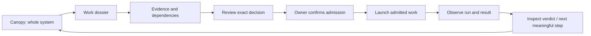

# Native Cambium architecture proposal

2 November 2026. Source-backed design, not implemented Swift modules. Initial
audience is founder/operator with tenant/role boundaries. The first usable release
must **coordinate decisions and launch already-admitted work from the Mac app**.
A read-only Canopy is an intermediate milestone, not the v1 done condition.
Root ISA owns acceptance; proposed stories and this architecture describe the
implementation work to articulate next.

## Primary experience

Each transition can expose a hold or a missing source without breaking navigation.
Reviewing, deciding, launching, executing and accepting are separate events.
The user can inspect or return at every stage. Keyboard and an accessible linear
route expose the same meaning as the optional spatial scene.

## Component and effect boundaries

| Proposed module | Responsibility | Allowed effects / exclusions |
| --- | --- | --- |
| CambiumApp | Scenes, menus, selection, command routing | Presentation/local UI only |
| Domain | Work IDs, typed edges, reader scope, revisions, observations | Pure immutable values and validation |
| ReadClients | Owner-scoped transport and decoding | Reads only; no hidden decision/renew/dispatch/foldback writes |
| CommandCoordinator | Review and launch state machines | Calls explicit owner-specific action protocols; cannot invent eligibility |
| GateClient | Complete review, decision, status, separately scoped renewal | Canonical server-owned identity/tuple; no owner key in app |
| LaunchClient | Request launch of exact already-admitted work | Proposed scoped owner seam; no arbitrary shell or runner-token API |
| RunClient | Original request/attempt status, terminal/evidence references | Readback; never auto-reexecute on timeout |
| KnowledgeClients | Selected Field Theory references, cited Cortex, Field Report | Separate adapters, schemas and consent |
| RuntimeClient | Redacted host/plant capability and work observations | Observes owner capability; no settings/provider repair |
| DesignKit | Semantic tokens, controls, glyphs and asset lineage | No operational data ownership |
| LocalState | Preferences, scene state, minimal recovery references | No task/approval/lease authority or credential/corpus dump |

The View layer receives command availability and a deliberate review coordinator;
it does not construct raw action payloads or call generic transport endpoints.
Read and action protocols remain structurally distinct. Command names describe
the person's job: Open evidence, Review decision, Launch admitted work, View result.
Detailed protocol identifiers belong in the inspector.

## Read envelope

The current Worker response includes a `projection`, `delivery` freshness,
separately digested portfolio catalog/summary, join report and organ-delivery
plan or summary. A graph-only decoder is insufficient for Canopy.

The native domain should distinguish:

- requested reader scope versus server-resolved/authorized scope;
- graph version/digest versus portfolio catalog/classification/pair digests;
- content `asOf` versus transport `servedAt` and expiry;
- authored source topology versus operational facts and historical evidence;
- incomplete/truncated collections versus empty collections;
- an illustrative organ-delivery plan versus a persisted active delivery.

Strict decoding checks schema/version, typed values, bounded collections,
timestamps, exact tenant/subject joins and canonical digests. The existing
TypeScript client is a useful local semantic reference; it does not validate every
native domain field or expose all sidecars. Swift/TypeScript canonical JSON parity
needs frozen cross-language vectors before a native client trusts its recomputation.
Content digests are not producer signatures or freshness proofs.

## Gate state machine

`unavailable → reviewable → reviewed → confirming → submitting → recorded`

Alternative terminal/display states: denied, changed, expired, rejected, conflict,
or outcome unknown. A changed digest/head/version requires a fresh complete
review. A historical receipt has no fabricated requested decision. Status-only
recovery keeps the original tuple; it never silently submits the decision again.

The current canonical source binds founder/tenant, full change set, confirmation,
nonce, version, expiry and D1 CAS. Native authentication and credential exchange
remain unimplemented. A browser session, role label or URL field cannot supply
native admission. The native product needs an owner-reviewed identity flow.

## Launch state machine and missing owner seam

`inspect admission → validate current owner capability → user launches → request
recorded → queued → owner claimed/running → terminal → verdict/learning`

Unknown, busy, refused, expired, revoked, capability-unavailable and interrupted
are explicit cases. The native coordinator records a bounded recovery reference
before transmitting and reuses its identity. A timeout moves to status recovery,
not a fresh dispatch. Restart must reconcile queued/running/terminal outcomes
through the owner before offering another launch. Cancellation is shown only if
the selected owner contract actually supports and authorizes it.

Current Cambium source has bridge enqueue, directive polling, execution claim,
artifact, outcome and ACK protocols. These are scoped admin/member/runner paths.
They are not a ready-made native-founder launch API. The app must not carry a
shared runner token, claim a lease as Hermes, post an executor attestation, or use
the generic enqueue route to turn an arbitrary graph node into work.

Required owner contract, proposed name `NativeLaunchCapability` (not an existing
schema): current principal/tenant, exact WorkObject/task/admission, graph revision,
loadout and input digest, execution plant, supported action, limits/expiry and
recovery/status reference. Launch response needs a durable request/attempt binding
and distinct accepted/queued/busy/unknown outcomes. The owning service rechecks
eligibility atomically; UI validation is only early feedback.

Two plant adapters are required by the long vision:

- **Hands:** local Temperance execution, project/worktree isolation and governed
  worker admission. The installed host's supported command interface must be
  bound and tested; no universal launcher was established in this repository.
- **Hermes:** admitted company-agent work through the remote owner. Existing
  source shows claim → execution → outcome/artifact → ACK with lease fencing and
  no side-effect replay during outcome recovery. The UI requests/observes this
  owner; it does not embed the runner.

For initial native acceptance, name at least one supported launchable work class
and its owner. Full generic execution breadth is not implied by that canary.
Unsupported classes stay visible with an explicit next owner step. The v1 contract
still requires a real admitted launch and result, not a permanently disabled button.

## Local storage and native boundaries

Preferences use local settings; view restoration is lightweight. Structured read
cache is optional and reader-scoped. Operational payloads start memory-only;
opaque original decision/launch references may persist with a deliberate retention
policy. No credential or raw prompt/response corpus enters logs or normal cache.
Sign-out/tenant changes invalidate incompatible context. Offline means inspectable
source or labelled historical data, with no inferred current eligibility.

SwiftUI owns navigation, dossiers, review and run controls. A native 2D graph is
the preferred first prototype. Compare an isolated WebKit/R3F scene for optional
spatial orientation using the same task and evidence. No engine choice has yet
been verified in a native build. Source art/mesh files remain references until
their exact derivative, review state and packaging are accepted.

## Validation responsibilities

| Layer | Proof needed |
| --- | --- |
| Domain/read decode | Cross-language canonical vectors, malformed/time/scope/cap/join regressions |
| Authentication | Actual native callback/exchange, cancellation/expiry/revocation and tenant isolation |
| Gate | Complete review, CAS/expiry races, immutable receipt and status-only recovery |
| Launch | Exact admission/pin/plant, idempotency, busy/refusal, lost-response and restart reconciliation |
| Run/result | Owner-bound attempt/artifact, terminal readback, independent verdict and missing acceptance |
| Native UI | Light/dark states, keyboard/VoiceOver, text/resize/reduced motion, realistic founder task |
| Release | Signed actual bundle, install/upgrade/recovery on intended Mac and no previous-app collision |

No narrow local test or source diagram satisfies all these layers. The discovery
plan names their producing owners and probes before implementation.

Sources: [directional map](research/DATA-FLOWS.md), [real lineage](research/LINEAGE.md),
[foundation](research/FOUNDATION.md), [current handler](../../../workers/quests/src/handler.ts),
[Gate host](../../../workers/quests/src/founder-access-host.ts),
[foldback consumer](../../../workers/quests/src/foldback-mission-consumer.ts),
[native work stories](STORIES.md).
