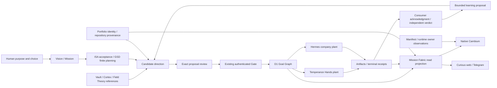

# Native Cambium — system discovery

2 November 2026. E5 discovery checkpoint. Source-backed research and proposed
product direction, with a fresh read-only Curious UI observation. No native
application has been scaffolded or built by this pass. This is a bounded review
of the named sources, not an exhaustive census of every portfolio repository.

The founder's opening job is **see the whole system, then choose the next
meaningful action**. That is the organizing requirement. The application should
make meaning, dependencies and evidence legible before inviting an action.
The first audience is founder/operator with tenant/role isolation. The founder
also selected **coordinate decisions and launch already-admitted work from the
Mac app** for the first usable release. Read-only orientation is an intermediate
milestone; decisions, owner-bound launch, result observation and recovery are
required in the release design.

Acceptance is root [`ISA.md`](../../ISA.md), ISC-3140–3171. The existing
Cloudflare milestone remains under [GSD state](../../.planning/STATE.md).
The app [brief](../../apps/cambium-mac/docs/BRIEF.md) and
[roadmap](../../.planning/native-mac/2026-11-02-ROADMAP.md) are research proposals.

## Vision and mission

[`VISION.md`](../../VISION.md) defines continued meaningful play through
coordinated finite games. It protects participation, adaptation, plurality,
learning and renewal. A beautiful dashboard, revenue number or completed
backlog does not complete that infinite game.

[`MISSION.md`](../../MISSION.md) pursues a provenance-preserving architecture
connecting doctrine, finite goals, planning, evidence and learning. It still
uses the v0.4 event horizon, while current GSD tracks v0.5 consolidation. This
requires an explicit doctrine review; app research does not renew it implicitly.

Product interpretation: Cambium helps a person maintain the conditions for
meaningful work, choose one bounded finite game, learn from its outcome, and
choose again. It should convey purpose and possibility alongside operational
constraints. A screen dominated by holds would miss the Vision just as much as
a scene filled with invented progress would miss its evidence requirements.

## Current-state reconciliation

| Material | What it establishes | Treatment for the new app |
| --- | --- | --- |
| Root Vision/Mission | Enduring and renewable doctrine | Reference and explain; review horizon drift explicitly |
| Root ISA | Accumulated acceptance and evidence, including dated release iterations | Preserve IDs and historical scope; append this research slice |
| GSD STATE/ROADMAP | v0.5 Cloudflare authority and source reconciliation | Separate finite lane; no native-app completion inferred |
| October 1 modular Mac review/design/plan | Workstation replacement and always-on node reconstruction | Integration constraints only; it is not an app specification |
| October 1 growth review | Five operating organs, six cognitive organs, six Will desks and four cell verbs | Reuse topology with current source checks |
| October 7 integration review | Source/runtime separation and missing joins at that date | Valuable hypotheses; some foldback findings are superseded |
| October 25 Gate/Expedition handoffs | Dated deployment and selected authenticated desktop receipts | Preserve bounded historical proof; no fresh complete-loop or device claim |
| Electron/R3F desktop engine | Existing Mac package and spatial visual implementation | Retain as reference and recovery path; no retirement implied |
| Curious | Browser/Telegram experience, source world, authenticated work and Gate seams | Peer product surface using shared owners |
| Proposal-only ecosystem JSON | Historical node/edge sketch, including known stale identities | Never ingest as a live inventory or recreate retired planes |

Fresh source correction: `handler.ts` now consumes discovered immutable foldback
references into Mission Fabric and supports terminal foldback persistence under
an injected owner. `index.ts` composes `wave0OwnerBindings`; that binding requires
the appropriate D1/R2/key/activation prerequisites before attested acceptance is
available. The October 7 statement that foldback was absent from the serving path
is stale. Current source composition is established; live configuration and
accepted end-to-end work were not verified here.

Organ-update delivery remains a different case: the inspected route validates
and compiles an instruction, and the compiler excludes network/storage/scheduling
effects. Its served plan is not proof of an active delivery.

## System ownership and directional data flow

This is a role map. Arrows do not attest installed, admitted or live execution.

| Owner/system | Reads and receives | Produces/feeds | Native app boundary |
| --- | --- | --- | --- |
| Human | Meaning, evidence, uncertainty and alternatives | Reviewed intent and bounded decisions | Preserve agency; no inferred approval |
| Vision / Mission | Reviewed doctrine evidence | Direction for finite pursuits | Doctrine read/reference only |
| ISA / GSD | Approved scope, proofs and plan dependencies | Acceptance / finite execution state | Show separate roles; no new shadow planner |
| Portfolio catalog/root map | Canonical WorkObjects and reviewed repository membership | Identity/provenance sidecar | Exact IDs; aliases and folders do not admit work |
| D1 Goal Graph | Reviewed version-bound change set | Operational state, approvals and events | Sole operational writer; app consumes its guarded API |
| Mission Fabric | Owner facts, packets, graph, skills, runs, receipts | Tenant-scoped deterministic read projection | Validate schema, tenant, joins, digest, freshness and gaps |
| Temperance / Hands | Admitted scope and pinned capabilities | Bounded local execution and artifacts | External execution owner; no shell-command convenience bridge |
| Hermes | Company directives, leases and delivery instructions | Remote execution, terminal evidence and Telegram transport | Distinct plant; never assume Mac paths or loopback work remotely |
| Plexus / Access | Verified issuer/audience, active identity and role | Principal/tenant ceilings | Browser login alone grants no work authority |
| OmniRoute | Governed combo, eligible account/model and budget | Inference attempt and attributed receipt | Gateway reachability is weaker than usable capacity |
| Manifest / Speculum | Redacted owner events and project observations | Runtime/phase/workflow glass | A visible plan or ready label is not dispatch |
| Cortex | Tenant/project/plane-scoped evidence and queries | Cited bounded retrieval and learning references | Preserve plane, audience and member scope |
| Vault | Canonical durable knowledge and registries | References used by products and retrieval | Knowledge authority, not a runtime dependency or copied corpus |
| Field Theory | Bookmarks, Library, Commands, seeds and repo surveys | Possible directions, scored nodes and goal prompts | Separate product; user-selected bounded source adapter proposed |
| Field Report | Spatial records, dated research and user direction | Reviewable observation/direction proposals | Separate product; existing local compiler is proposal-only |
| Factor / Meristem | Reviewed knowledge and brand DNA | Scoped reference and Genesis capability outputs | No automatic skill promotion from extracted material |
| Growth / Will desks | Research, product evidence, draft and editorial context | Commercial proposals, delivery/publication receipts, observed outcomes | Extract/feed/read/edit are distinct effects and owners |
| Session Atlas | Owner-authorized local history sources | Redacted historical projection | No native session-store import into the app or Git |
| Antahkarana | Bounded workflow envelopes | Preview/confirm/receipt results | Optional independent adapter, not universal acceptance |
| Snow Gloves | Its own capability/node/fleet records | Independently owned product observations | Optional peer; no shared installer or required runtime |
| GitHub / release / cloud owners | Reviewed source and approved release packets | Source history, roadmap and deployment receipts | Repository commit, cloud deploy and Mac distribution are different proofs |

## Organs, desks and time scales

The operating organs are Genesis, Taste, Hands, Will and Cortex. The finite
composition is Genesis → Taste → Hands → Will; Cortex is cross-cutting.
Vestibule, Adytum, Nutrix, Auspex, Circulator and Praeceptor are six cognitive
organs with distinct orientation, synthesis, learning and health functions.
Eleven portraits do not require eleven top-level navigation destinations.

The six Will desks are roles inside the operating loop. They are not six new
services. A growth cell's extract, feed, read and edit operations must retain
their different ownership, revision and promotion boundaries. A read or watcher
must not silently become an edit, promotion, publication or message send.

The app needs to relate fast work/attempt events, medium planning and learning
cycles, and slow doctrine renewal. Their clocks and completion tests differ.
Repository Mission, a bounded `FabricMission`, and the Mission screen are three
different concepts. Neither a UI visit nor completion of one operational mission
renews repository doctrine.

## Distinct graphs

| Graph/view | Nodes and relationships | What it can answer |
| --- | --- | --- |
| Portfolio | WorkObject, repositories, components, dependencies | What exists and who owns it? |
| Repository Intent Graph | Doctrine, planning, evidence, learning references/digests | Why does this finite work exist? |
| D1 Goal Graph | Versioned operational goals, tasks, approvals and CAS | What is admitted and committed? |
| Mission Fabric | Work, mission, task, agent, cluster, run, receipt | What do those owner facts mean together for this reader? |
| Execution/evidence lineage | Admission, pin, attempt, artifact, consumer, verdict | What actually happened and was accepted? |
| Knowledge/Possible | Source, seed, survey, direction, critique, score | What could be worth doing, based on which source? |

A shared visual vocabulary can connect these views without flattening their
authority. Use explicit lenses and typed edges. An authored source connection,
implemented adapter and freshly observed operational link need distinct labels.

## Feedback and failure dynamics

**Work/learning loop:** purpose → reviewed intent → admission → finite execution
→ evidence → independent acceptance → bounded learning → next reviewed intent.
The learning return does not directly mutate D1 or routing policy. Those have
different owner approval paths.

**R1, useful learning:** better accepted evidence increases useful retrieval;
better retrieval can improve subsequent bounded decisions and accepted evidence.
This is a design hypothesis, not a measured productivity claim.

**B1, evidence discipline:** unverified actions increase uncertainty; visible
uncertainty prompts verification; verification reduces uncertainty before the
next action. A clearly explained hold can move work forward by identifying the
missing evidence instead of merely blocking a button.

**R2, dashboard drift:** copied status increases divergent representations;
divergence encourages more manual explanations and copied status. Break this
loop at ingestion with owner envelopes, portable identities and visible expiry.

**B2, attention limits:** more notifications and graph detail increase attention
cost, reducing useful review. Use change summaries, focused paths and meaningful
notifications with source links; do not turn every organ into a noisy heartbeat.

Diagnose down the L1 ask / L2 context / L3 harness / L4 loop / L5 graph stack.
One specialty, one exit and one turn cap stays a loop. Multiple durable
specialties/dependencies justify a graph. More agents are not the default repair.

## Field Theory and Field Report

Installed Field Theory CLI metadata reports version 1.3.22. Its supported
surfaces include bookmarks, Library Markdown, portable Commands, active-document
context, seeds and Possible. The inspected flow is:

`bookmark-backed seed → brief → repository survey → generate → critique → score
→ saved direction/node → exportable goal prompt`.

Saved results and navigation indexes are not accepted operational work. No
dedicated Cambium/Curious/Field Report adapter was located in the inspected CLI
implementation. This is a bounded search result, not proof about all software.
The Library search for Cambium returned no results; raw bookmark/note bodies
were not imported or copied for this review.

Proposed join: a user selects a source or Possible node, Cambium receives a
bounded evidence envelope, reconciles portable repository/WorkObject identity,
and prepares a candidate next step. Missing tenant, identity, revision or
admission stays visible. Any later accepted learning writes back through the
owning interface, with a separately reviewed change.

Field Theory's current document update uses complete Markdown plus
`--expected-sha256`; its source path is not permission to bypass that protocol.
Its app and CLI have different license families in installed documentation.
Prefer the supported CLI/contracts; do not transplant its app implementation.

Cambium's existing `bin/operator/onboarding/field-observation.ts` is explicitly
for Field Report, not Field Theory. It validates a version-bound selected
record and returns `proposal-only`, `awaiting-human-review`, `admitted:false`,
`executionAllowed:false`, retaining source/API/tenant/admission holds.
The connected Field Report direction context returned a dated research snapshot,
with action approval and execution completion both false. No connector write ran.

## Platform and surface scope

| Surface | Role for this design | Current evidence / proposed work |
| --- | --- | --- |
| New native Mac client | Daily whole-system orientation and focused next action | Proposed; no Swift sources found under existing apps |
| Existing Electron/R3F | Spatial desktop implementation and reference | Source exists; preserve until a separate migration decision |
| Curious browser | Shared source exploration and authenticated operational views | Fresh read-only UI observation below |
| Telegram Mini App | Situated mobile/pocket operation | Existing contracts and dated acceptance; device proof separate |
| Portfolio Workbench | Identity reconciliation and proposal preparation | Reusable semantics; no silent duplication of writer |
| CLI / MCP / plugins | Agent and operator entry points | Each tool has its own principal, scope and effect contract |
| Runtime glass / TUI | Local runtime, planning and recovery observations | Independent host owners and evidence |
| Future iPhone/iPad/Windows/web changes | Possible product horizons | No commitment made by choosing SwiftUI for Mac |

Fresh IAB observation on 2 November: Curious loads “Cambium · Mission Control,”
shows “Source exploration · access needed,” and offers eight districts: Purpose,
Identity, Organs, Plant, Evidence, Growth, Knowledge and Holds. The chart states
that visits are local exploration and do not advance work. Founder Gate is
labelled “Gate read held.” Entering the world and opening its chart were the
only interactions. This proves those served UI labels/navigation at observation
time, not authenticated operational reads, a new decision or backend health.

## First product architecture proposal

The expanded [native architecture](../../apps/cambium-mac/docs/ARCHITECTURE.md)
now specifies effect boundaries, full served envelopes, canonical decision and
admitted-launch state machines, result/restart recovery and the missing native
owner capability. [Directional flows](../../apps/cambium-mac/docs/research/DATA-FLOWS.md)
and the [Fitcheck trace](../../apps/cambium-mac/docs/research/LINEAGE.md) bind it
to source. [Apple research](../../apps/cambium-mac/docs/research/PLATFORM.md)
corrects the WebKit API path and separates availability from support; bounded
[interaction research](../../apps/cambium-mac/docs/research/INTERACTION-REFERENCES.md)
informs overview, focused review and contextual commands.

Use native SwiftUI navigation, menus, dossiers, review sheets, inspectors,
settings and accessible linear paths. Retain Cambium's visual identity through
a deliberate design kit, terrain, glyphs, rails and bounded source derivatives.
The first visual slice should work as 2D content; spike spatial rendering
separately before committing to WebKit or a native scene renderer.

Proposed modules, to validate before implementation:

- Domain: immutable portable IDs, envelopes and independent evidence/connection/
  decision state; no UI or transport effects.
- Read adapters: owner-scoped protocol clients and validation; no write-capable
  convenience operations. Some existing reads use POST; method is not effect.
- Action gateway: isolated proposal/confirmation/status interfaces using the
  existing server owner, with no signing keys embedded in the app.
- Execution coordination: launch exact already-admitted supported work through
  an owning Hands/Hermes interface, observe its run and recover the original
  request. Existing runner credential/claim protocols are not a native launch API.
- View models: selection and derived presentation from validated envelopes.
- Design kit: semantic tokens and real controls with all interaction states.
- Local store: preferences and disposable reader-scoped cache. Cache is never
  authoritative and is invalidated on reader/tenant changes.

Do not assume the current CLI Access-cookie flow is a finished native login
contract. Source verifies identity and tenant server-side, binds complete review,
digest, nonce, revision and expiry, and returns canonical D1 receipts. Telegram
and browser paths have different credentials. Native authentication/callback,
session expiry, signing, notarization, sandbox/local-network behavior and the
deployment target need explicit platform probes.

Decision, connection and execution remain independent models. A lost response
recovers through original-tuple status only. Historical receipts survive a
disconnected queue; no automatic resubmission or optimistic business success.

## Analysis coverage and evidence limits

Eight IterativeDepth lenses were applied: literal (requested scope/assets/Bama),
stakeholder (founder/team/owner systems), failure (identity, stale reads and lost
responses), temporal (historical plans and renewal), experiential (whole-system
orientation), constraint inversion (offline source inspection), analogical
(existing dossier/inspector patterns) and meta (new product versus host migration).
They produced the 32 bounded research probes in the existing ISA; they do not
stand in for future functional app tests.

FirstPrinciples separates purpose, exact identity, evidence and next action from
inherited UI forms. SystemsThinking supplies the four loops above. BeCreative
compared an immersive world, a decision inbox, a project cockpit, a knowledge
canvas and an overview-with-dossier composition; the last best matches the
founder answer while preserving an optional spatial world. This is a design
recommendation, not founder perceptual acceptance.

Three native read-only specialist passes reviewed topology, assets and Field
Theory. Routed Observe failed before analysis because the installed Codex config
rejects the context7 transport. No provider/model resolution is claimed and host
configuration was not repaired. An Advisor returned useful concerns but explicitly
had not read the Gate security path; its objections were checked against primary
source before adoption. Independent final review is recorded separately.

## Source anchors

- [Architecture](../../ARCHITECTURE.md), [integration](../../INTEGRATION.md),
  [loops to graphs](loops-to-graphs.md), [continuous learning](temperance-continuous-learning-integration.md).
- [Growth review](2026-10-01-growth-ecosystem-review.md),
  [Mac migration review](2026-10-01-modular-mac-system-review.md),
  [October integration review](2026-10-07-ecosystem-visual-integration-review.md).
- [Mission Fabric contract](contracts/mission-fabric-v1.md),
  [system atlas](contracts/system-atlas-v1.md), [Curious visual contract](contracts/curious-workbench-v1.md).
- [Owner binding source](../../workers/quests/src/wave0-owner-bindings.ts),
  [handler](../../workers/quests/src/handler.ts),
  [Field Report observation](../../bin/operator/onboarding/field-observation.ts),
  [bounded text retrieval](../memory/text-retrieval.md).
- [Founder Gate contract](contracts/founder-gate-cli-v1.md),
  [transport](../../workers/quests/src/founder-decision-transport.ts),
  [host](../../workers/quests/src/founder-access-host.ts),
  [decision service](../../workers/quests/src/founder-decision.ts).

Exact repository bytes used for this pass are listed in the companion
[`source ledger`](2026-11-02-native-cambium-sources.json). A hash proves inspected
source identity, never live behavior or approval.
