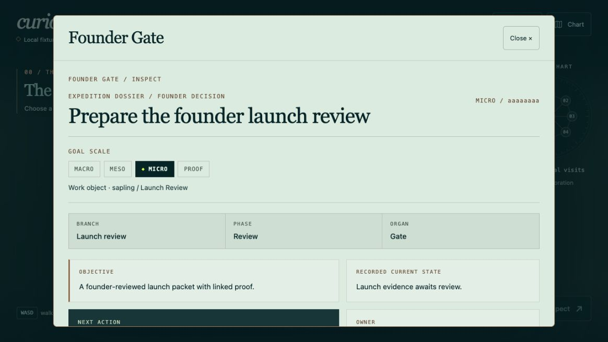
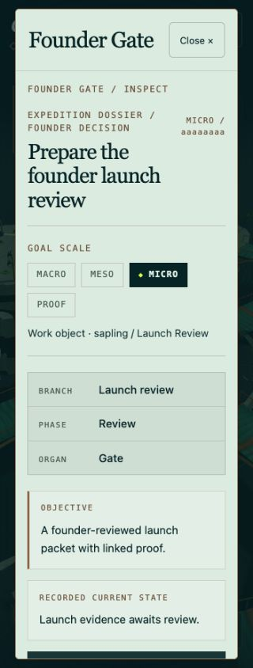
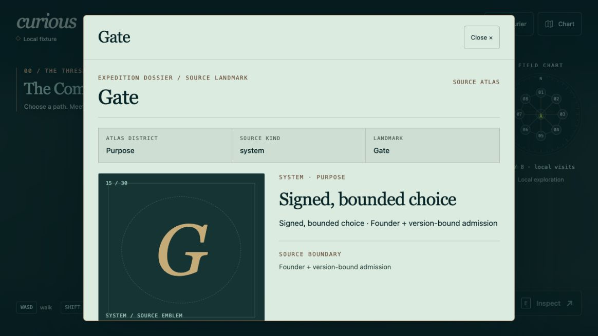

# Expedition Dossier local review evidence

These screenshots show a synthetic local fixture in the Codex in-app browser. They contain no live founder session, customer record or runtime approval. Evidence is tied to implementation commit `a2d58ab32eabbf0d0d032febbb529bf133e51818`; the following publication commit adds only documentation and these artifacts.

## Screenshots

### Desktop mission dossier

### Narrow mission dossier

### Source landmark folio

The source landmark screenshot is an atlas folio, not a queue or proof of runtime progress. The desktop dossier screenshot shows explicit scope and independent branch, phase and organ metadata from the synthetic reviewed proposal.

## Test evidence

- App suite: **171 tests, 171 pass, 0 fail, 0 skipped**. Includes 16 pure-model tests for available tuple checks, unique subjects, malformed deltas and cross-tenant ancillary nodes.
- Selected host/page/Gate/read/atlas integration suite: **37 tests, 37 pass, 0 fail, 0 skipped**.
- TypeScript/Vite build: passed.
- Generated world bundle parity: passed; 727324 bytes; digest in [evidence.json](evidence.json).
- Independent source review: no remaining blockers after canonical tuple, ancillary delta, scope-label and focus-ring corrections.

Exact commands, implementation SHA and artifact hashes are in [evidence.json](evidence.json). Raw bounded browser geometry is in [browser-evidence.json](browser-evidence.json): actual320x844 viewport; document scrollWidth320; dialog clientWidth280 equals scrollWidth280; observed decision controls at least45px high. Keyboard focus, full-review disclosure, reduced motion, expired/unserved context and confirmation/cancel were exercised without signing.

This is focused local browser evidence. The canonical mobile viewport/trusted-touch release proof remains held. Neither these screenshots nor source tests establish live deployment, founder admission or downstream execution. No full-core-suite result is claimed for this patch.

## Remaining metadata gaps

- Branch, phase and organ labels require explicit `metadata.branch`, `metadata.phase` and `metadata.organ` on the exact canonical reviewed goal. Missing values remain **Not served**. An atlas district never supplies an executing organ or goal scale.
- Readable work-object and loadout names may be supplied as `metadata.workObjectLabel` and `metadata.loadoutLabel`; otherwise the interface formats the canonical ID and retains the full ID in review details.
- Macro/meso/micro/proof indicates the node's actual scope. Ancestor labels and navigable parent breadcrumbs need a future authoritative ancestry projection; this patch does not invent that graph.
- Objective, owner, next action, waiting condition, proof requirement and delta counts need a valid matching complete canonical review. A stale or malformed projection cannot populate them.

No new runtime service, environment variable, migration or binding is required. Rollout is separate and is not part of this draft publication.
