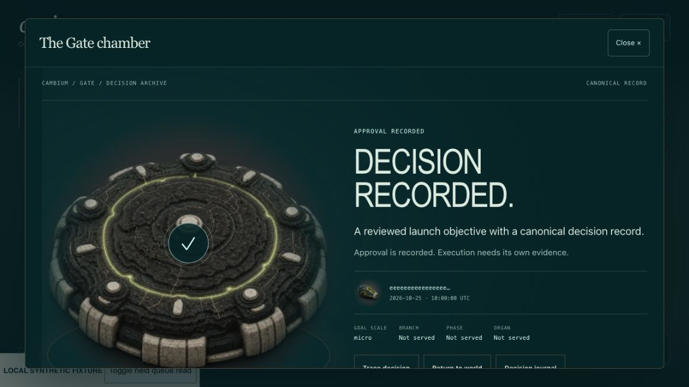
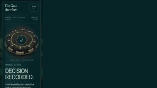
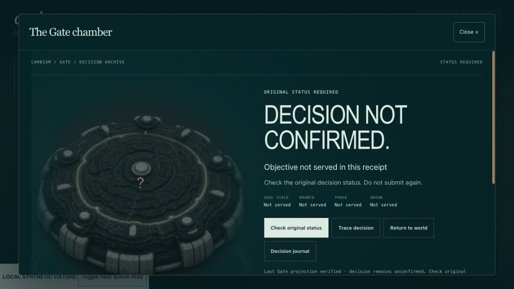

# Production Gate chamber review evidence

These screenshots use the actual assembled PAGE and its real host bridge against local synthetic responses. They are not live approvals or proof of downstream execution.

The browser exercised existing /proposal→/status wiring without a pending row, retained record/context after the queue became held, receipt/review/trace disclosures, keyboard focus, return/journal navigation, reduced motion and actual320px containment. A valid pending status read remains distinct from a connection failure. Local fixtures reject decision/renewal writes, and both counters stay0.

App184/184, independent world/bridge112/112, strict build and generated-bundle parity pass. Exact geometry, payload, artifact hashes and request counters are in [source-evidence.json](source-evidence.json). Canonical mobile viewport/trusted-touch proof remains held; these focused browser checks do not replace it.

The legacy-page pin was strictly updated after independent verification that replacing only the reviewed Gate bridge restores its prior hash. No equality assertion was weakened. The fullcore suite is rerun against the committed frozen checkout; its result is recorded in the final release receipt. Runtime promotion is separately verified with exact bindings/settings parity and a previous-version rollback.

Identity, tenant admission, fresh complete predecision review, explicit confirmation, duplicate-family fence and original-tuple status-only recovery remain required. Existing records can be inspected without a new business decision. No endpoint, migration, enrollment or runtime-service change is needed.
